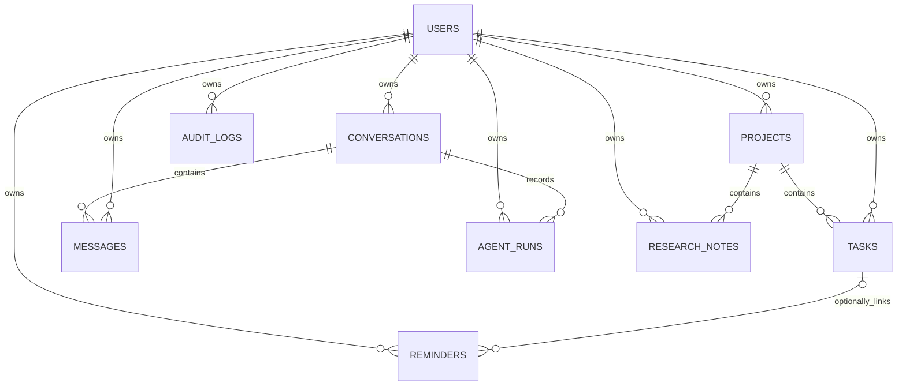

# Database design and implementation

All application operations use **direct PostgreSQL SQL through psycopg**. Pydantic validates API input; it is not an ORM. There is no SQLAlchemy, Alembic, or model-generated SQL executor.

## Tables and invariants

| Table | Purpose | Important guarantees |
| --- | --- | --- |
| users | Accounts | UUID PK; unique normalized email; password hash only |
| projects | Related work | Owner FK; status CHECK; optimistic version |
| tasks | Actionable items | Composite project/owner FK; title, priority/status CHECKs; version |
| reminders | Scheduled prompts | Optional composite task/owner FK; aware timestamp |
| conversations | Chat sessions | Owner FK |
| messages | Persistent messages | Composite conversation/owner FK; user/assistant role CHECK |
| agent_runs | Execution trace | Composite conversation/owner FK; status CHECK; JSON plan/results |
| audit_logs | Mutation trace | Owner FK; entity/action and bounded metadata |
| research_notes | Cited project notes | Composite project/owner FK; source URLs in JSON |

Composite foreign keys prevent a task owned by one user from referencing another user's project, even if a service-level check is accidentally omitted. The API also filters every owned record access. Cascading project deletion removes tasks, linked reminders, and research notes; it requires confirmation.

The schema also includes `schema_migrations` and LangGraph checkpoint infrastructure tables. These are implementation infrastructure, separate from the nine application entities. Checkpoint state is keyed by run UUID; only owned run endpoints can resume it.

## DBMS concepts to explain

- **Normalization:** separate projects, tasks, reminders and messages. Foreign keys represent relationships. JSON stores variable execution traces and reference metadata, not comma-separated task entities.
- **Atomicity:** project, initial tasks, and their audit entries commit together. A failing task rolls all of them back.
- **Consistency:** NOT NULL, UNIQUE, CHECK and composite FK constraints reject invalid states.
- **Isolation:** row locks protect update and approval operations; version checks reject stale edits.
- **Durability:** application data and LangGraph approval checkpoints persist in PostgreSQL.
- **Joins and aggregation:** task/project joins, counts by status, and project completion are used by the real interface.
- **Indexes:** owner/status/deadline and relationship indexes support common access patterns. Tiny demo tables may correctly use sequential scans.
- **Views:** `pending_task_summary` is a reusable join view. Callers must still bind the current user's ID.
- **Auditing:** service functions write audit events within the mutation transaction. An audit row cannot survive a rolled-back write.

## Query safety

Values use psycopg `%s` bindings. Internal dynamic identifiers use a fixed allowlist and `psycopg.sql.Identifier`. Agent plans select typed operations; they never provide SQL. The explorer maps template IDs to fixed read-only statements, and the backend supplies authenticated ownership parameters.

Mutation steps have their own transaction boundaries. A create-project-with-tasks operation is atomic. A longer AI command can have earlier committed steps when a later step fails; the UI preserves those confirmed results and reports failure honestly.

On restart, queued/planning/executing runs become `interrupted`. Paused approvals retain durable checkpoints and can resume. Approval is isolated from mutation nodes because LangGraph restarts an interrupted node from its beginning. Resume requests lock the run and reject repeats.

## Migrations and references

`backend/migrations/001_initial.sql` is the full application schema. `python -m app.db` applies only unapplied numbered SQL files; the ledger and DDL commit together under a PostgreSQL advisory transaction lock. New changes should use a new migration file, preserving existing files after submission.

See [PostgreSQL constraints](https://www.postgresql.org/docs/current/ddl-constraints.html), [psycopg parameter binding](https://www.psycopg.org/psycopg3/docs/basic/params.html), and [LangGraph interrupts](https://docs.langchain.com/oss/python/langgraph/interrupts).
